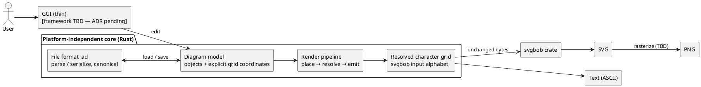

# 2. Architecture Vision

> *The "big picture" before details: which quality goals drive the design, what technical risks exist, and which cross-cutting concepts unify the solution.*

**Big picture:** the user edits a *diagram model* (objects with explicit grid coordinates) in a thin GUI; a platform-independent core turns that model — by pure functions only — into a resolved character grid, from which every output is derived: text *is* the grid, SVG is `svgbob` interpreting the same grid, PNG is a rasterization of the SVG.

## 2.1 Constraints (design-level)

| Constraint | Source | Impact on design |
|---|---|---|
| One codebase → Windows, macOS, Linux **and** browser (WASM) | NFR1 / Q2 | Core is platform-independent Rust; no native-only dependencies in core (parser must stay dependency-free); GUI framework must be able to target all four — ADR pending (tracked in [§5](05-constraints.md)) |
| No automatic layout, ever | NFR3 / Q1 | The model stores explicit coordinates; rendering is a pure lookup pipeline — no layout engine, no randomness, canonical serialization (`serialize(parse(s)) == s`) |
| Files human-readable without a renderer | NFR2 / Q3 | Custom plain-text line-based format `.ad` with explicit per-line element statements ([ADR 004](../adr/004-diagram-file-format.md)) — not JSON/YAML, not rendered art |
| Core unit-testable headlessly, ≥80% coverage | NFR5 / Q5 | All model/format/render/export logic lives in shared crates driven by plain data in → text/SVG/PNG out; GUI stays thin and is never needed for tests |
| Deterministic vector output | FR5, [ADR 005](../adr/005-use-svgbob-as-vector-renderer.md) | SVG interpretation is delegated to the proven `svgbob` crate on exactly the text-output bytes — no second rendering path to keep in sync |

## 2.2 Key Quality Goals

| # | Key quality goal | Measurable target |
|---|------------------|-------------------|
| Q1 | Deterministic output | Same model → byte-identical text *and* byte-identical SVG; `serialize(parse(s)) == s`; enforced by golden-file tests (exact numbers/scenarios in [§6](06-quality-model.md)) |
| Q2 | Cross-platform portability | One codebase builds and passes the same test suite on Windows, macOS, Linux, and WASM; WASM bundle size budget TBD ([§6](06-quality-model.md)) |
| Q3 | Open, readable format | Opening a `.ad` file in any text editor shows shapes, labels, and positions; diffs in git are meaningful line-by-line changes |
| Q4 | Low learning curve | A new user composes a first diagram without documentation (NFR4); UI limited to template sidebar + canvas (FR6) |
| Q5 | Testable core | Rendering/export logic runs headlessly with no windowing dependencies; ≥80% line coverage on the core crates (`cargo tarpaulin`) |

## 2.3 Prioritization of Quality Goals

1. **Q1 Determinism** — the product's core promise (the reason it exists instead of PlantUML). Every other goal may bend for this one; nothing may break it.
2. **Q3 Open format** — the product's identity: text you own, forever. Drives the custom `.ad` format and svgbob-compatible output.
3. **Q2 Portability** — a hard requirement (Obj. 4), satisfied by *architecture* (crate split, dependency discipline) rather than feature work; constrains every dependency choice.
4. **Q5 Testable core** — the enabler that makes Q1/Q3 verifiable at all; cheap to uphold because the core is pure functions.
5. **Q4 Usability** — important for adoption but the most flexible: minimal UI (FR6) already bounds the surface area.

Conflicts & trade-offs:

- **Q2 (WASM) vs. feature richness:** the core must stay lightweight and dependency-free, so convenience features that need heavy/native libraries are deferred or done in pure Rust (e.g. PNG rasterizer choice is constrained by this — see R3).
- **Q1 (canonical output) vs. format flexibility:** byte-stable serialization restricts how freely the `.ad` grammar can evolve; mitigated by the versioned header ([ADR 004](../adr/004-diagram-file-format.md)).
- **Q3 (readability) vs. extensibility:** collections, connectors, and anchor metadata must stay line-oriented and comment-friendly rather than nested structures.

## 2.4 Technical Risks

| # | Risk | Impact | Likelihood | Mitigation idea |
|---|------|--------|------------|-----------------|
| R1 | **GUI framework choice:** one framework/codebase targeting native desktop *and* WASM is unproven territory for us; a wrong pick reworks the entire front end | High | Medium | Dedicated ADR before any GUI code (gated by [§5](05-constraints.md)); keep the GUI thin and the core independent so the framework stays swappable |
| R2 | **Glyph resolution edge cases:** ambiguous cells (5+ connections, text under an edge, overlapping objects) need defined fallback rules; undefined behavior here breaks Q1 silently | Medium | High | Table-driven glyph mapping with the svgbob spec as reference ([ADR 001](../adr/001-glyph-resolution-alphabet.md) follow-up); golden-file tests for every pattern incl. fallbacks |
| R3 | **PNG rasterization on all four targets:** no proven pure-Rust SVG→PNG path validated for WASM + desktop yet (rasterizer TBD in [C2](12-concepts/render-pipeline.md)) | Medium | Medium | Evaluate pure-Rust rasterizers early; PNG is FR5-Medium — degradable to "SVG only" without touching the rest of the pipeline |
| R4 | **Upstream `svgbob` dependency:** label escaping and parser edge cases depend on an external crate's behavior; upstream changes could shift SVG output or reject valid grids | Medium | Low | Pin the crate version; golden tests pinning `svgbob::to_svg` output for our canonical grids; report/fix upstream issues rather than forking |

## 2.5 Cross-cutting Concepts

- **Single source of truth: the diagram model.** Objects with explicit grid coordinates are *the* data. Everything else — file bytes, character grid, text, SVG, PNG — is derived from it by pure functions and never stored independently.
- **The resolved character grid is the one intermediate representation for all outputs** (concept [C2](12-concepts/render-pipeline.md)). Text output *is* the grid; SVG is `svgbob` interpreting those same bytes — so "every output matches the text" holds by construction, not by synchronization.
- **What you place is what you get.** There is no layout engine anywhere in the pipeline — the architectural answer to the PlantUML spaghetti problem (NFR3).
- **Plain text at every layer.** File format, shape templates, collections, and rendered output are all human-readable text ([ADR 004](../adr/004-diagram-file-format.md), [ADR 007](../adr/007-user-defined-diagram-objects.md), [ADR 001](../adr/001-glyph-resolution-alphabet.md)) — the whole product speaks one language.
- **Determinism is a testable contract, not a hope.** Golden-file tests over grid/text/SVG make Q1 an executable assertion in CI (NFR5).
