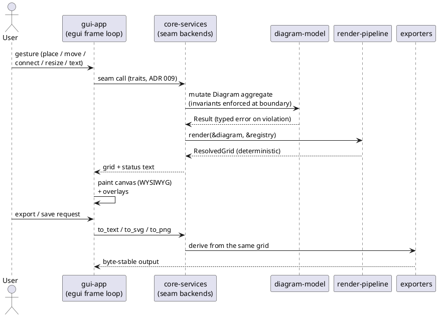

# 7. Solution Strategy

> *The architectural approach at a high level — the "how" before the "what".*

## 7.1 Cross-cutting Concepts (concrete)

> *Elaborate [§2.5](02-architecture-vision.md#25-cross-cutting-concepts): name each cross-cutting concept and how it is realized.*

- **WYSIWYG canvas.** The canvas paints exactly what the export produces: fixed glyph resolution (C1), a fixed canvas background, and overlays (selection handles, anchor dots, resize grips) drawn *on top* of — never into — the rendered surface. Verified by golden-file tests that re-render after every UI change.
- **Determinism / byte stability.** The same diagram always renders to the same text/SVG/PNG (QS7). Realized as: pure functions in the core crates (data in → grid out, no clocks/randomness/iteration-order leaks), a canonical `.ad` serializer, and golden-file + determinism-invariant tests in CI ([S-020](../stories/S-020-performance-benchmarks.md)).
- **Plain-text-first.** The resolved character grid is the single source for all outputs: text is the grid as-is; SVG (svgbob) and PNG are derived from it, so every format matches exactly (C2).
- **One codebase, many targets (Q2).** Headless core crates carry 100% of the logic; `gui-app` is a thin egui/eframe layer. Platform differences (native vs wasm) are cfg-gated at the service/app seams only — zero forks in the core.
- **Bounded contexts as crate boundaries (C3, ADR 011).** Five bounded contexts + application/presentation layer, each owning one model/language; context mapping (Customer/Supplier, OHS/shared kernel, Repository, ACL) defines how they talk (§8).
- **Service seam (ADR 009).** The GUI depends on `ui-api` traits (`DiagramStore`, `Renderer`, `Exporter`, `ShapeCatalog`), not concrete backends — `core-services` provides the real implementations and fakes for tests, so the whole app is testable headlessly.

## 7.2 Runtime View (strategy level)

> *Which major runtime interactions exist? Details: [§9](09-runtime-view.md).*

The frame loop never blocks: model mutation and rendering are inline (µs-scale — 500 objects render in ≈ 0.41 ms measured, [§6](06-quality-model.md)); only PNG rasterization may run on a worker thread (native) per [ADR 012](../adr/012-responsive-ui-threading.md).

## 7.3 Deployment View (strategy level)

> *Where and how does the system run? Details: [§10](10-deployment-view.md).*

Two targets, one codebase — **native desktop binary** (winit + wgpu) and a **static web bundle** (wasm32-unknown-unknown via Trunk, servable from any static host). There is **no server component at all**: no API, no database, no runtime network. State is local to the machine/browser (options JSON; documents on disk or in an in-memory store with download-on-save).

## 7.4 Development View (strategy level)

> *How is the code organized at top level? Details: [§8](08-building-block-view.md), per-crate detail in [§13](13-building-blocks-detail.md).*

A Cargo workspace of **9 crates**: five headless bounded contexts (`diagram-model`, `ad-format`, `shape-registry`, `render-pipeline`, `exporters`), the v1+ import stub (`ascii-import`), the application-layer seam (`ui-api` traits + `core-services` backends/composition root), and the presentation layer (`gui-app`). The dependency DAG is machine-checked by an audit test in `core-services`. Testing is tiered: unit tests in-crate, headless full-app frame pumping (tier 0b), golden-image visual tests, plus the **feature bar** — every feature story ships a UI-driven diagram decomposition test. Quality gates per change: fmt, clippy (`clippy::all` deny), full test suite, coverage ≥ 80% (tarpaulin), `mkdocs build --strict`, and the wasm targets' compile/test gates.
