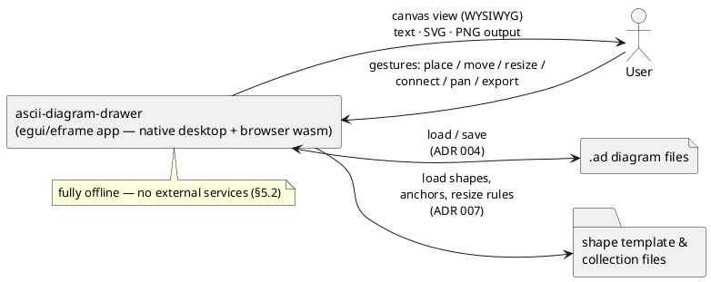
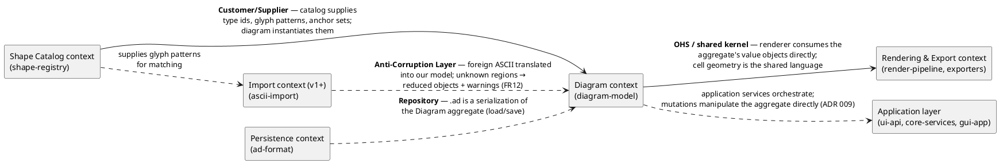
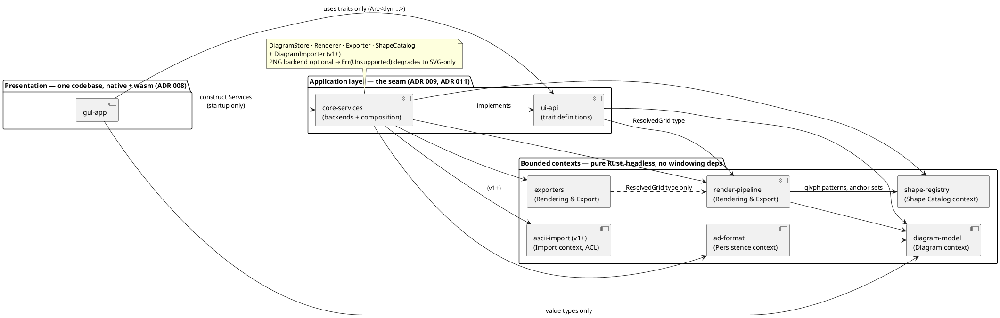

# 8. Building Block View

> *Static decomposition of the system, top-down. Level 0 = whole system; each level zooms into one building block from the previous level.*
>
> *Status note: this is a **design-level** decomposition organized with **Domain-Driven Design** ([ADR 011](../adr/011-domain-driven-design.md)): strategic design (subdomains → bounded contexts → context mapping, §8.2) plus selected tactical patterns (§8.4). Bounded contexts are **crate boundaries inside one binary** — no distributed contexts. Derived from [ADR 001](../adr/001-glyph-resolution-alphabet.md), [ADR 004](../adr/004-diagram-file-format.md), [ADR 005](../adr/005-use-svgbob-as-vector-renderer.md), [ADR 007](../adr/007-user-defined-diagram-objects.md), [ADR 008](../adr/008-gui-framework-choice.md) and [ADR 009](../adr/009-ui-api-service-layer.md), plus the concepts in [§12](12-concepts/index.md). Crate/module names are proposals until the workspace is scaffolded.*

## 8.1 Level 0: System Overview



## 8.2 Domain Analysis (Strategic Design)

### 8.2.1 Subdomains

| Subdomain | Type | Why |
|-----------|------|-----|
| **Diagram composition & editing** — place/move/resize shapes, anchor-bound connectors, grid alignment | **Core** | The product's differentiator: manual placement with no auto-layout (§1 Background); objectives 1, 6, 7 |
| **Deterministic rendering & export** — model → resolved grid → text/SVG/PNG from the *same* grid | **Core** | The WYSIWYG promise and Q1 determinism: every output must match the text exactly; this is where "pasteable anywhere" (Obj. 2) happens |
| **Shape catalog & templates** — predefined shapes, user-defined objects, collections, anchor sets, resize rules | Supporting | Enables Obj. 3 but is commodity: storage + lookup of shape definitions |
| **Persistence (.ad format)** — plain-text serialization of the diagram | Generic | No domain logic beyond lossless round-trip and versioning ([ADR 004](../adr/004-diagram-file-format.md)); any competent text format would do |
| **ASCII import** (v1+) — foreign ASCII art → editable diagram | Supporting | Convenience path with a defined lifecycle (FR12); adds no core capability |

### 8.2.2 Bounded Contexts

Each bounded context owns its own model and language; here they are realized as crates inside one binary ([ADR 011](../adr/011-domain-driven-design.md)). The mapping is documented as concept [C3](12-concepts/bounded-contexts.md).

| Bounded context | Subdomain | Crate(s) | Owns (its language) |
|-----------------|-----------|----------|---------------------|
| **Diagram** (core domain) | Composition & editing | `diagram-model` | the `Diagram` aggregate, objects, cell geometry, anchors, invariants |
| **Shape Catalog** | Catalog & templates | `shape-registry` | `ShapeType`, `Collection`, glyph patterns, anchor sets, resize rules |
| **Rendering & Export** | Rendering & export | `render-pipeline`, `exporters` | `ResolvedGrid`, glyph resolution (C1/C2), text/SVG/PNG emission |
| **Persistence** | .ad format | `ad-format` | `.ad` syntax, versioning, parse errors — a *serialization* of the Diagram aggregate, not a second model |
| **Import** (v1+) | ASCII import | `ascii-import` | region segmentation, template matching, `ImportResult` — an anti-corruption layer around foreign ASCII |
| **Application & Presentation** (not a domain context) | — | `ui-api`, `core-services`, `gui-app` | application services (the [ADR 009](../adr/009-ui-api-service-layer.md) seam), composition root, egui views/gestures |

### 8.2.3 Context Mapping



Mapping rules:

- **Diagram ← Catalog — Customer/Supplier.** `ShapeInstance` carries only a `type_id`; full meaning (glyph pattern, anchors) is resolved through the catalog at render time. The catalog can evolve independently; the diagram never embeds catalog internals.
- **Diagram → Rendering & Export — Open Host Service with a shared kernel.** The renderer consumes the aggregate's value objects (`CellPos`, `CellSize`, anchor refs) directly — same process, no translation layer. Cell geometry is the shared language between these contexts.
- **Persistence — Repository.** `.ad` documents are *serializations* of the Diagram aggregate: one canonical model, lossless round-trip (QS7). The parser produces the aggregate; there is no separate "format model".
- **Import (v1+) — Anti-Corruption Layer.** Foreign ASCII art is a different language; the import context translates it into our model and quarantines what it cannot understand (unknown regions → fixed-size reduced objects + warnings, FR12). No other context ever sees raw foreign text.
- **Application layer** — the `ui-api`/`core-services` seam ([ADR 009](../adr/009-ui-api-service-layer.md)) *is* the application-layer boundary of this structure: application services behind traits, a composition root per target, and direct aggregate manipulation for mutations (no "model service").

## 8.3 Level 1: Building Blocks

Nine crates — five bounded-context crates (`ascii-import` is v1+; all headless and GUI-free per NFR5/Q5), the two-crate **application-layer seam** ([ADR 009](../adr/009-ui-api-service-layer.md)), and one presentation crate that compiles to native **and** wasm ([ADR 008](../adr/008-gui-framework-choice.md)):

| Building block | Bounded context | Purpose | Interfaces (in → out) | Depends on |
|----------------|-----------------|---------|------------------------|------------|
| `diagram-model` | **Diagram** (core domain) | Pure domain model: objects, grid coordinates, anchors, invariants — the `Diagram` aggregate ([C4](12-concepts/diagram-aggregate.md)) | construction/mutation API → `Diagram` value type | — (leaf) |
| `ad-format` | **Persistence** | Open plain-text file format: parse/serialize, versioning ([ADR 004](../adr/004-diagram-file-format.md)) | `&str` → `Result<Diagram, ParseError>`; `Diagram` → `String` | diagram-model |
| `shape-registry` | **Shape Catalog** | Predefined shapes + user templates/collections; per-type anchor sets; resize rules ([ADR 007](../adr/007-user-defined-diagram-objects.md)) | template/collection files → `ShapeRegistry`; lookup by `type_id` | diagram-model (types) |
| `render-pipeline` | **Rendering & Export** | Pure renderer: place → resolve → **resolved character grid** ([concept C2](12-concepts/render-pipeline.md), [ADR 001](../adr/001-glyph-resolution-alphabet.md)) | `&Diagram, &ShapeRegistry` → `ResolvedGrid` | diagram-model, shape-registry |
| `exporters` | **Rendering & Export** | Text / SVG / PNG emission from the one grid ([ADR 005](../adr/005-use-svgbob-as-vector-renderer.md), FR5) | `&ResolvedGrid` → `String` (text/SVG), bytes (PNG) | render-pipeline (grid type), svgbob |
| `ascii-import` | **Import** (v1+) | **ASCII import of foreign diagrams (F9/FR12):** text → grid → region segmentation → template matching → editable `Diagram`; unknown regions → fixed-size reduced objects + warnings | `&str, &ShapeRegistry` → `ImportResult { diagram, warnings }` | diagram-model, shape-registry, render-pipeline (grid type) |
| `ui-api` | **Application layer** | **Service seam:** five object-safe traits (`DiagramStore`, `Renderer`, `Exporter`, `ShapeCatalog`, `DiagramImporter` v1+) + shared service types ([ADR 009](../adr/009-ui-api-service-layer.md)) | trait definitions → consumed by GUI and backends | diagram-model, render-pipeline (grid type) |
| `core-services` | **Application layer** | Concrete backends + composition root: `Services::native()` / `web()`, PNG backend optional ([ADR 009](../adr/009-ui-api-service-layer.md)) | `Services` aggregate wired into the GUI at startup | ui-api, all core crates |
| `gui-app` | **Presentation layer** | egui/eframe editor: template sidebar + WYSIWYG canvas, gestures → model mutations, file/export UX ([ADR 008](../adr/008-gui-framework-choice.md)) | user gestures → view + model mutations + exports | **ui-api, core-services (construction), diagram-model types**, egui/eframe — never the concrete context crates |



**Coupling strategy.** Loose coupling here is *static and structural* — enforced at compile time by Rust's visibility system + Cargo's dependency graph, not by runtime messaging (no event bus between components, §8.6). Five mechanisms:

1. **Crate = context boundary ([ADR 011](../adr/011-domain-driven-design.md)).** Each bounded context is its own crate; Rust visibility makes the public API *the* contract — internals are private by default, and reaching into another context requires a declared Cargo dependency.
2. **One-way DAG, no cycles** (enforced by the Q5.2/T5 architecture test): strictly presentation → application layer → contexts, never the reverse.
   - `gui-app` may depend **only** on `ui-api`, `core-services` (construction), and `diagram-model` value types — never directly on `ad-format` / `shape-registry` / `render-pipeline` / `exporters` ([ADR 009](../adr/009-ui-api-service-layer.md)).
   - Within the application layer: `core-services → ui-api + contexts`; `ui-api → {model, pipeline grid type}`.
   - Between context crates: `ad-format → model`, `render-pipeline → {model, registry}`, `exporters → pipeline` (grid type only), `ascii-import → {model, registry, pipeline grid type}` (v1+).
   - No windowing/event-loop dependency anywhere; platform IO is confined to the store backends in `core-services` and to `gui-app`.
3. **Context mapping = the only sanctioned cross-context communication (§8.2.3).** Each edge has a named pattern and a narrow currency: opaque `type_id`s (Catalog → Diagram); immutable value objects — no handles or interior mutability crossing boundaries (Diagram → Rendering); aggregate in/out (Repository); quarantined foreign text (ACL). *If you need to communicate across contexts and no mapping covers it, that is a design signal → ADR* — not an ad-hoc import.
4. **Trait seam with dependency inversion — only where implementations are swappable ([ADR 009](../adr/009-ui-api-service-layer.md)).** The GUI depends on `ui-api` abstractions; concrete backends are injected at the composition root (`core-services`). That is the *only* classic DIP boundary in the system, because it is the only one with per-target/optional implementations (file IO, PNG). Everywhere else, loose coupling means narrow public APIs + value types — not indirection for its own sake.
5. **No shared utility crate, no re-exports.** A common `utils` crate is a classic coupling leak (everything depends on it → de-facto shared kernel). Shared code belongs in the owning context (e.g. grid types live in `render-pipeline`) or is duplicated if small; re-exporting another context's types is forbidden (pass-through coupling).

**Machine-checked, not review-dependent:** T5's dependency audit asserts this DAG — planned as a workspace test that parses each crate's `Cargo.toml` and checks the declared edges against the allow-list above (§8.5 open items).

**Proposed workspace layout:**

```
ascii-diagram-drawer/
├── Cargo.toml                 # workspace
├── crates/
│   ├── diagram-model/         # Diagram context (core domain) — pure data + invariants
│   ├── ad-format/             # Persistence context — .ad parse/serialize (ADR 004)
│   ├── shape-registry/        # Shape Catalog context — shapes, templates, anchors (ADR 007)
│   ├── render-pipeline/       # Rendering & Export context — place → resolve → grid (ADR 001)
│   ├── exporters/             # Rendering & Export context — text / svg / png (ADR 005)
│   ├── ascii-import/          # Import context (ACL) — ASCII import of foreign diagrams, v1+ (F9)
│   ├── ui-api/                # Application layer — service traits, the seam (ADR 009)
│   └── core-services/         # Application layer — backends + composition root (ADR 009)
└── gui-app/                   # Presentation layer — eframe app, native + wasm32 target
```

## 8.4 Level 2: Context Internals (Tactical Design)

### 8.4.1 Diagram context — `diagram-model`

- **Aggregate root:** `Diagram { objects: Vec<Object> }` — stable document order = z-order. All invariants are enforced at the aggregate boundary; invalid states are unrepresentable ([C4](12-concepts/diagram-aggregate.md)).
- **Entities** (identity matters — stable ids): `Object::Shape(ShapeInstance) | Text(TextInstance) | Connector(ConnectorInstance)`
  - `ShapeInstance { id, label, type_id, pos: CellPos, size: CellSize }` — all coordinates in **cell units** (grid alignment, FR7); `type_id` is the *only* reference into the Catalog context (§8.2.3); `label` renders inside the shape
  - `ConnectorInstance { id, from: AnchorRef, to: AnchorRef, style }` — bound to anchors, not raw coordinates (FR9). Anchor *sets* (named cells relative to the shape origin, FR11, [ADR 007](../adr/007-user-defined-diagram-objects.md)) are catalog data owned by `shape-registry` (§8.4.2); the Diagram context only carries the references.
- **Value objects:** `CellPos`, `CellSize`, `AnchorRef` — immutable geometry, equality by value.
- **Invariants:**
  - *Boundary-enforced* (at construction and on every mutation — `diagram-model` is a leaf crate and sees no catalog): unique object ids; single-token ids/type-ids/anchor names; non-zero sizes (`CellSize ≥ 1×1`); scale ≥ 1; connector endpoints reference existing objects that are shapes.
  - *Render-time* (need the shape catalog — `render-pipeline` alone sees both sides, per §8.2.3): an anchor name resolves to a cell inside its shape's bounds.
- **Mutations:** intent-revealing operations on the root (`place_shape`, `place_text`, `move_object`, `resize`, `connect`, `remove`, `set_scale`) — never field pokes from outside (no anemic model, §8.6). The GUI manipulates this aggregate directly, deliberately bypassing the seam ([ADR 009](../adr/009-ui-api-service-layer.md)).
- **Sub-modules:** `objects`, `anchors`, `invariants`.

### 8.4.2 Shape Catalog context — `shape-registry`

- **Aggregates:** `ShapeType { id, glyph_pattern: TemplateGrid, anchor_set: AnchorSet, resize_rules: Option<…> }` and `Collection { name, types }`.
- **Sub-modules:** `builtin` (predefined catalog + standard default anchors incl. UML connection points, FR11), `templates` (user template/collection files, [ADR 007](../adr/007-user-defined-diagram-objects.md)), `resize-rules` (**v1+** — v1 shapes are fixed-size), `registration` (**v1+**, FR12).
- **What it supplies to other contexts:** each `ShapeType.glyph_pattern` is the matching target consumed by the Import context (§8.4.5, v1+) — the catalog *stores* patterns and anchor sets; it does no matching itself.

### 8.4.3 Rendering & Export context — `render-pipeline`, `exporters`

- **Domain service:** `render(&Diagram, &ShapeCatalog) -> ResolvedGrid` — spans two contexts (aggregate + catalog), so it lives as a free function/service rather than on either aggregate.
- **Value object:** `ResolvedGrid { width, height, cells: Vec<Cell> }` — one canonical-alphabet glyph per occupied cell; the grid is a **derived intermediate, never stored** ([ADR 004](../adr/004-diagram-file-format.md)).
- **Sub-modules (pipeline):** `place`, `connectors` ([connector routing, concept C9](12-concepts/connector-routing.md)), `resolve` ([glyph resolution, concept C1](12-concepts/glyph-resolution.md)), `grid`.
- **Key algorithms:** stamp objects in document order (z-order) → per-cell glyph selection from N/E/S/W connections + content (§8.5); strictly row-major traversal and fixed priority orders — no hash-iteration order may reach the output (Q1, T1). Connectors re-resolve both anchors to cells on every render, then route straight or as a single-corner L of structural edges with an arrowhead at the target end ([ADR 013](../adr/013-connector-routing.md)) — joins stay clean because route cells resolve through the same C1 rule table as borders.
- **Exporters** (`text`, `svg`, `png` sub-modules) present the one grid in three media:
  - *Text*: dump the resolved grid as UTF-8 with LF — the grid **is** the output.
  - *SVG*: pass the resolved grid **unchanged** to `svgbob::to_svg` — no adapter layer ([ADR 005](../adr/005-use-svgbob-as-vector-renderer.md)); fixed attribute set, no timestamps → byte-identical re-export (QS1/QS2).
  - *PNG*: rasterize the produced SVG. **Rasterizer TBD** — must work on native *and* wasm32 (risk R3; v1 may degrade to SVG-only if needed).

### 8.4.4 Persistence context — `ad-format`

- **Repository pattern:** `.ad` is a serialization of the Diagram aggregate (§8.2.3) — load = parse → aggregate, save = serialize → text. No format-specific model exists.
- **Sub-modules:** `parser`, `serializer`, `versioning`, `errors`.
- **Key data structures:** textual `.ad` document per [ADR 004](../adr/004-diagram-file-format.md) with a version header; parse errors carry line/column.
- **Key algorithms:** deterministic serialization (object order = document order → stable diffs, Q3); lossless round-trip `load(serialize(m)) ≡ m` as a property test (QS7); unknown-field tolerance within one major version (QS8).

### 8.4.5 Import context (v1+) — `ascii-import`

- **Anti-corruption layer** around foreign ASCII art (§8.2.3): translates an external language into our model and quarantines what it cannot understand.
- **Factory:** the `assemble` step constructs a well-formed `Diagram` aggregate from matched regions (invariants hold by construction).
- **Sub-modules:** `gridify` (raw ASCII text → character grid, reusing the pipeline's grid type), `segment` (region detection), `match` (template matching against catalog `glyph_pattern`s), `assemble` (`Diagram` construction).
- **Key data structures:** `ImportResult { diagram: Diagram, warnings: Vec<ImportWarning> }`; unknown regions become fixed-size reduced objects until registered — the FR12 lifecycle.
- **Key algorithms:** per-region template matching — exact `glyph_pattern` match first, then bounded tolerance; deterministic (no iteration-order dependence, Q1); known regions become editable `ShapeInstance`s carrying their type's anchor set (FR11). Exposed to the GUI only as the `DiagramImporter` service ([ADR 009](../adr/009-ui-api-service-layer.md)).

### 8.4.6 Application layer — `ui-api`, `core-services`

- **Application services** — the five object-safe traits of [ADR 009](../adr/009-ui-api-service-layer.md): `DiagramStore { load, save }` (repository for the Diagram aggregate); `Renderer { render(&Diagram, &ShapeCatalog) -> ResolvedGrid }`; `Exporter { to_text, to_svg, to_png }` where `to_png` may return `Err(Unsupported)`; `ShapeCatalog { list, get, anchors, register (v1+) }`; `DiagramImporter { import(&str) -> Result<ImportResult, ImportError> }` (v1+); plus `StoreError` & co.
- **Sub-modules:** one module per trait — `store`, `render`, `export`, `catalog`, `import` (v1+) — plus shared error types.
- **Composition root** (`core-services`): backends + `Services { store, renderer, exporter, catalog: Arc<dyn …> }` with per-target constructors `Services::native()` / `Services::web()`; backend selection at construction time (target + build configuration); missing PNG backend → `Err(Unsupported)` path — graceful degradation to SVG-only without any GUI change (R3 as an option, not a fork).
- **The two importers, clearly separated:** `DiagramStore::load` imports *our own* format — file bytes → `ad-format` parser → `Diagram` (FR4). `DiagramImporter` imports *foreign* ASCII art and constructs an editable model from it (F9, v1+).
- **Rules:** signatures use only model/grid types + std — no IO internals leak through the seam; traits stay object-safe (`dyn`-friendly) so GUI code holds `Arc<dyn …>` without generics.

### 8.4.7 Presentation layer — `gui-app`

- **Sub-modules:** `canvas` (view), `interaction` (gestures), `sidebar` (templates, FR6), `commands` (model-mutation boundary), `io` (file dialogs / clipboard UX on top of `DiagramStore` — per-target native APIs, [ADR 008](../adr/008-gui-framework-choice.md) consequences).
- **Key design decision — WYSIWYG canvas:** the canvas draws the **resolved character grid in a monospace font** — i.e. the exact bytes of the text output — with selection/anchor handles as an overlay on top. What the user sees *is* what gets exported; no separate vector preview that could diverge from the text. (Proposed here; promote to an ADR if contested.)
- **Key algorithms:** per-frame immediate-mode re-render of grid + overlays (bounded by P2, ≤16 ms/frame); gesture → grid-snapped mutation (display zoom is view-only; the scale control changes rendered spacing at model level, FR8); connectors drawn anchor-to-anchor with live re-binding on move/resize (FR9).
- **Backends injected, not imported ([ADR 009](../adr/009-ui-api-service-layer.md)):** the app struct holds `Services`; view code calls only `ui-api` traits — which is what makes in-memory fakes possible for GUI tests (T7). Diagram *mutation* deliberately bypasses the seam and manipulates the pure `Diagram` aggregate directly.
- **Why the GUI names model types directly:** the seam's own signatures do (`Renderer::render(&Diagram, &ShapeCatalog)`), the canvas reads object geometry every frame for drawing and hit-testing, and the sidebar instantiates shapes via aggregate operations. `diagram-model` is an in-memory value type, not a backend — depending on it is *not* "touching a backend".
- **Temporary editor state stays here:** selection, drag-in-progress, zoom/pan are view state of the app struct — never a backend component. A stateful "Canvas / editor-session" service behind the seam was considered and rejected: in-memory mutation has no swappable backend ([ADR 009](../adr/009-ui-api-service-layer.md) non-abstraction). If multi-document or undo/redo ever requires a session object, that is an ADR 009 version bump — not a silent addition.
- **Targets:** one codebase → native (winit + wgpu/glow) and browser wasm (WebGL) per [ADR 008](../adr/008-gui-framework-choice.md).

## 8.5 Level 3: Module Internals (as needed)

Two modules' complexity demand a third level of zoom: the **resolve stage** of `render-pipeline`, and (v1+) **region matching in `ascii-import`**.

- **Input:** per occupied cell — the set of connections passing through it (N/E/S/W) plus content kind (shape border/fill, connector line, text glyph).
- **Output:** exactly one glyph from the canonical svgbob alphabet ([ADR 001](../adr/001-glyph-resolution-alphabet.md)).
- **Algorithm sketch:** classify the junction — cross > T-junction > corner > straight (deterministic priority table; ties broken by fixed order, never by iteration order); text cells pass through unchanged.
- **Open spec point:** the full rule table (connection set × content → glyph) is finalized during implementation and pinned immediately by golden tests + the alphabet-purity property test (T1/T3).
- **ASCII import matching (v1+, open spec point):** segmentation of the input grid into candidate regions, scoring against each `glyph_pattern` (exact match first, then bounded tolerance), deterministic tie-breaking; unmatched regions → fixed-size reduced objects + warnings (FR12). Pinned by golden tests when implemented.

**Other open items carried from earlier chapters:** T5 dependency-audit mechanism — extend the headless-only audit to assert the full allowed DAG of §8.3 (workspace test parsing each crate's `Cargo.toml` edges; pinned at scaffolding); PNG rasterizer choice — now a backend selection inside `core-services`, not an architectural fork (§8.4.3/§8.4.6, risk R3); exact `ui-api` trait signatures pinned at workspace scaffolding ([ADR 009](../adr/009-ui-api-service-layer.md) follow-up); template/collection file naming & extension ([ADR 007](../adr/007-user-defined-diagram-objects.md) follow-up); exact default anchor set per predefined shape (FR11).

## 8.6 Deliberately Not Adopted

DDD is applied with a scalpel, not a sledgehammer — the following are explicitly **out of scope** for this project ([ADR 011](../adr/011-domain-driven-design.md)):

- **No CQRS, no event sourcing, no domain-event bus.** Single-user local tool, one process; determinism (Q1) and simplicity beat distributed-systems patterns.
- **Bounded contexts are not services.** They are crate boundaries inside a single binary that compiles to native *and* wasm; there is no network between contexts, ever (§5.2 fully offline).
- **No anemic domain model.** Invariants live in the `Diagram` aggregate; mutations go through intent-revealing root operations, not field pokes from the GUI.
- **No per-context storage engines.** Persistence is one plain-text serialization of one aggregate (Repository pattern, §8.4.4).
