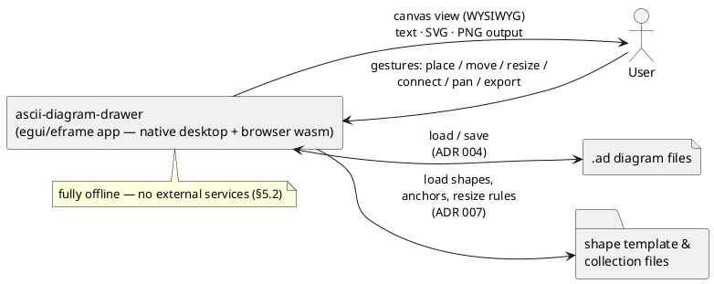
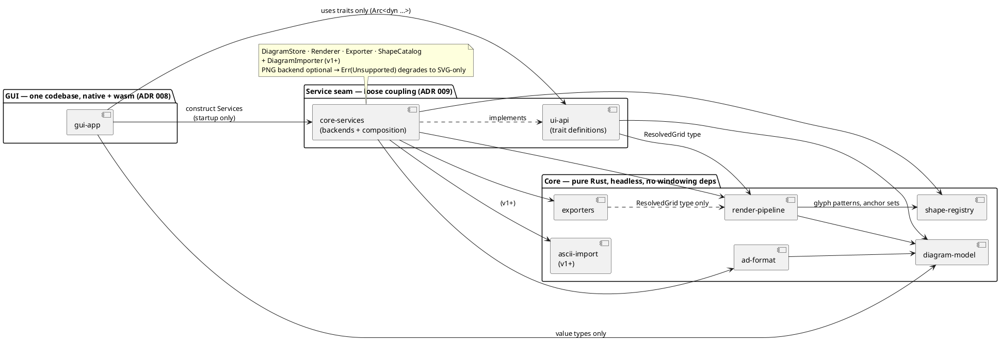

# 8. Building Block View

> *Static decomposition of the system, top-down. Level 0 = whole system; each level zooms into one building block from the previous level.*
>
> *Status note: this is a **design-level** decomposition derived from [ADR 001](../adr/001-glyph-resolution-alphabet.md), [ADR 004](../adr/004-diagram-file-format.md), [ADR 005](../adr/005-use-svgbob-as-vector-renderer.md), [ADR 007](../adr/007-user-defined-diagram-objects.md), [ADR 008](../adr/008-gui-framework-choice.md) and the concepts in [§12](12-concepts/index.md). Crate/module names are proposals until the workspace is scaffolded.*

## 8.1 Level 0: System Overview



## 8.2 Level 1: Major Components

Nine building blocks — six platform-independent core crates (five for v1, `ascii-import` for v1+; all headless and GUI-free per NFR5/Q5), a two-crate **service seam** for loose coupling ([ADR 009](../adr/009-ui-api-service-layer.md)), and one GUI application crate that compiles to native **and** wasm ([ADR 008](../adr/008-gui-framework-choice.md)):

| Building block | Purpose | Interfaces (in → out) | Depends on |
|----------------|---------|------------------------|------------|
| `diagram-model` | Pure domain model: objects, grid coordinates, anchors, invariants | construction/mutation API → `Diagram` value type | — (leaf) |
| `ad-format` | Open plain-text file format: parse/serialize, versioning ([ADR 004](../adr/004-diagram-file-format.md)) | `&str` → `Result<Diagram, ParseError>`; `Diagram` → `String` | diagram-model |
| `shape-registry` | Predefined shapes + user templates/collections; per-type anchor sets; resize rules ([ADR 007](../adr/007-user-defined-diagram-objects.md)) | template/collection files → `ShapeRegistry`; lookup by `type_id` | diagram-model (types) |
| `render-pipeline` | Pure renderer: place → resolve → **resolved character grid** ([concept C2](12-concepts/render-pipeline.md), [ADR 001](../adr/001-glyph-resolution-alphabet.md)) | `&Diagram, &ShapeRegistry` → `ResolvedGrid` | diagram-model, shape-registry |
| `exporters` | Text / SVG / PNG emission from the one grid ([ADR 005](../adr/005-use-svgbob-as-vector-renderer.md), FR5) | `&ResolvedGrid` → `String` (text/SVG), bytes (PNG) | render-pipeline (grid type), svgbob |
| `ascii-import` | **ASCII import of foreign diagrams (v1+, F9/FR12):** text → grid → region segmentation → template matching → editable `Diagram`; unknown regions → fixed-size reduced objects + warnings | `&str, &ShapeRegistry` → `ImportResult { diagram, warnings }` | diagram-model, shape-registry, render-pipeline (grid type) |
| `ui-api` | **Service seam:** five object-safe traits (`DiagramStore`, `Renderer`, `Exporter`, `ShapeCatalog`, `DiagramImporter` v1+) + shared service types ([ADR 009](../adr/009-ui-api-service-layer.md)) | trait definitions → consumed by GUI and backends | diagram-model, render-pipeline (grid type) |
| `core-services` | Concrete backends + composition root: `Services::native()` / `web()`, PNG backend optional ([ADR 009](../adr/009-ui-api-service-layer.md)) | `Services` aggregate wired into the GUI at startup | ui-api, all core crates |
| `gui-app` | egui/eframe editor: template sidebar + WYSIWYG canvas, gestures → model mutations, file/export UX ([ADR 008](../adr/008-gui-framework-choice.md)) | user gestures → view + model mutations + exports | **ui-api, core-services (construction), diagram-model types**, egui/eframe — never the concrete core crates |



**Dependency rules** (enforced by the Q5.2/T5 architecture test): strictly one-directional — GUI → seam → core, never the reverse.

- `gui-app` may depend **only** on `ui-api`, `core-services` (construction), and `diagram-model` value types — never directly on `ad-format` / `shape-registry` / `render-pipeline` / `exporters` ([ADR 009](../adr/009-ui-api-service-layer.md)).
- Within the seam: `core-services → ui-api + core`; `ui-api → {model, pipeline grid type}`.
- Within core: `ad-format → model`, `render-pipeline → {model, registry}`, `exporters → pipeline` (grid type only), `ascii-import → {model, registry, pipeline grid type}` (v1+).
- No cycles. No windowing/event-loop dependency anywhere; platform IO is confined to the store backends in `core-services` and to `gui-app`.

**Proposed workspace layout:**

```
ascii-diagram-drawer/
├── Cargo.toml                 # workspace
├── crates/
│   ├── diagram-model/         # leaf — pure data + invariants
│   ├── ad-format/             # .ad parse/serialize (ADR 004)
│   ├── shape-registry/        # shapes, templates, anchors (ADR 007)
│   ├── render-pipeline/       # place → resolve → grid (ADR 001)
│   ├── exporters/             # text / svg / png (ADR 005)
│   ├── ascii-import/          # ASCII import of foreign diagrams — v1+ (F9)
│   ├── ui-api/                # service traits — the seam (ADR 009)
│   └── core-services/         # backends + composition root (ADR 009)
└── gui-app/                   # eframe app — native + wasm32 target
```

## 8.3 Level 2: Component Internals

#### 8.3.1 `diagram-model`

- **Sub-modules:** `objects`, `anchors`, `invariants`.
- **Key data structures:**
  - `Diagram { objects: Vec<Object>, /* stable document order = z-order */ }`
  - `Object::Shape(ShapeInstance) | Text(TextInstance) | Connector(ConnectorInstance)`
  - `ShapeInstance { id, type_id, pos: CellPos, size: CellSize }` — all coordinates in **cell units** (grid alignment, FR7)
  - `AnchorSet` — named anchor cells *relative to the shape origin*, defined **per type** and shared by all instances (FR11, [ADR 007](../adr/007-user-defined-diagram-objects.md))
  - `ConnectorInstance { id, from: AnchorRef, to: AnchorRef, style }` — bound to anchors, not raw coordinates (FR9)
- **Key invariants** (enforced at construction — invalid states unrepresentable): integer cell coordinates; anchor cells inside their shape's bounds; connectors reference existing anchor refs.

#### 8.3.2 `ad-format`

- **Sub-modules:** `parser`, `serializer`, `versioning`, `errors`.
- **Key data structures:** textual `.ad` document per [ADR 004](../adr/004-diagram-file-format.md) with a version header; parse errors carry line/column.
- **Key algorithms:** deterministic serialization (object order = document order → stable diffs, Q3); lossless round-trip `load(serialize(m)) ≡ m` as a property test (QS7); unknown-field tolerance within one major version (QS8).

#### 8.3.3 `shape-registry`

- **Sub-modules:** `builtin` (predefined catalog + standard default anchors incl. UML connection points, FR11), `templates` (user template/collection files, [ADR 007](../adr/007-user-defined-diagram-objects.md)), `resize-rules` (**v1+** — v1 shapes are fixed-size), `registration` (**v1+**, FR12).
- **Key data structures:** `ShapeType { id, glyph_pattern: TemplateGrid, anchor_set: AnchorSet, resize_rules: Option<…> }`; `Collection { name, types }`.
- **Key data supplied to other blocks:** each `ShapeType.glyph_pattern` is the matching target consumed by the ASCII importer (§8.3.6, v1+) — the registry *stores* patterns and anchor sets; it does no matching itself.

#### 8.3.4 `render-pipeline`

- **Sub-modules:** `place`, `resolve` ([glyph resolution, concept C1](12-concepts/glyph-resolution.md)), `grid`.
- **Key data structures:** `ResolvedGrid { width, height, cells: Vec<Cell> }` — one canonical-alphabet glyph per occupied cell; the grid is a **derived intermediate, never stored** ([ADR 004](../adr/004-diagram-file-format.md)).
- **Key algorithms:** stamp objects in document order (z-order) → per-cell glyph selection from N/E/S/W connections + content (§8.4); strictly row-major traversal and fixed priority orders — no hash-iteration order may reach the output (Q1, T1).

#### 8.3.5 `exporters`

- **Sub-modules:** `text`, `svg`, `png`.
- **Key algorithms:**
  - *Text*: dump the resolved grid as UTF-8 with LF — the grid **is** the output.
  - *SVG*: pass the resolved grid **unchanged** to `svgbob::to_svg` — no adapter layer ([ADR 005](../adr/005-use-svgbob-as-vector-renderer.md)); fixed attribute set, no timestamps → byte-identical re-export (QS1/QS2).
  - *PNG*: rasterize the produced SVG. **Rasterizer TBD** — must work on native *and* wasm32 (risk R3; v1 may degrade to SVG-only if needed).

#### 8.3.6 `ascii-import` (v1+)

- **Sub-modules:** `gridify` (raw ASCII text → character grid, reusing the pipeline's grid type), `segment` (region detection), `match` (template matching against catalog `glyph_pattern`s), `assemble` (`Diagram` construction).
- **Key data structures:** `ImportResult { diagram: Diagram, warnings: Vec<ImportWarning> }`; unknown regions become fixed-size reduced objects until registered — the FR12 lifecycle.
- **Key algorithms:** per-region template matching — exact `glyph_pattern` match first, then bounded tolerance; deterministic (no iteration-order dependence, Q1); known regions become editable `ShapeInstance`s carrying their type's anchor set (FR11). Exposed to the GUI only as the `DiagramImporter` service ([ADR 009](../adr/009-ui-api-service-layer.md)).

#### 8.3.7 `ui-api`

- **Sub-modules:** one module per trait — `store`, `render`, `export`, `catalog`, `import` (v1+) — plus shared error types.
- **Key data structures:** the five object-safe traits of [ADR 009](../adr/009-ui-api-service-layer.md): `DiagramStore { load, save }`; `Renderer { render(&Diagram, &ShapeCatalog) -> ResolvedGrid }`; `Exporter { to_text, to_svg, to_png }` where `to_png` may return `Err(Unsupported)`; `ShapeCatalog { list, get, anchors, register (v1+) }`; `DiagramImporter { import(&str) -> Result<ImportResult, ImportError> }` (v1+); plus `StoreError` & co.
- **The two importers, clearly separated:** `DiagramStore::load` imports *our own* format — file bytes → `ad-format` parser → `Diagram` (FR4). `DiagramImporter` imports *foreign* ASCII art and constructs an editable model from it (F9, v1+).
- **Rules:** signatures use only model/grid types + std — no IO internals leak through the seam; traits stay object-safe (`dyn`-friendly) so GUI code holds `Arc<dyn …>` without generics.

#### 8.3.8 `core-services`

- **Sub-modules:** `store` (native fs / browser backends), `render` (thin wrapper over render-pipeline's pure functions), `export` (text/svg via svgbob + optional PNG rasterizer), `catalog` (builtin + file-backed collections), `import` (v1+ — adapter over `ascii-import`), `composition`.
- **Key data structures:** `Services { store, renderer, exporter, catalog: Arc<dyn …> }` with per-target constructors `Services::native()` / `Services::web()`.
- **Key algorithms:** backend selection at construction time (target + build configuration); missing PNG backend → `Err(Unsupported)` path — graceful degradation to SVG-only without any GUI change (R3 as an option, not a fork).

#### 8.3.9 `gui-app`

- **Sub-modules:** `canvas` (view), `interaction` (gestures), `sidebar` (templates, FR6), `commands` (model-mutation boundary), `io` (file dialogs / clipboard UX on top of `DiagramStore` — per-target native APIs, [ADR 008](../adr/008-gui-framework-choice.md) consequences).
- **Key design decision — WYSIWYG canvas:** the canvas draws the **resolved character grid in a monospace font** — i.e. the exact bytes of the text output — with selection/anchor handles as an overlay on top. What the user sees *is* what gets exported; no separate vector preview that could diverge from the text. (Proposed here; promote to an ADR if contested.)
- **Key algorithms:** per-frame immediate-mode re-render of grid + overlays (bounded by P2, ≤16 ms/frame); gesture → grid-snapped mutation (display zoom is view-only; the scale control changes rendered spacing at model level, FR8); connectors drawn anchor-to-anchor with live re-binding on move/resize (FR9).
- **Backends injected, not imported ([ADR 009](../adr/009-ui-api-service-layer.md)):** the app struct holds `Services`; view code calls only `ui-api` traits — which is what makes in-memory fakes possible for GUI tests (T7). Diagram *mutation* deliberately bypasses the seam and manipulates the pure `Diagram` value type directly.
- **Targets:** one codebase → native (winit + wgpu/glow) and browser wasm (WebGL) per [ADR 008](../adr/008-gui-framework-choice.md).

## 8.4 Level 3: Module Internals (as needed)

Two modules' complexity demand a third level of zoom: the **resolve stage** of `render-pipeline`, and (v1+) **region matching in `ascii-import`**.

- **Input:** per occupied cell — the set of connections passing through it (N/E/S/W) plus content kind (shape border/fill, connector line, text glyph).
- **Output:** exactly one glyph from the canonical svgbob alphabet ([ADR 001](../adr/001-glyph-resolution-alphabet.md)).
- **Algorithm sketch:** classify the junction — cross > T-junction > corner > straight (deterministic priority table; ties broken by fixed order, never by iteration order); text cells pass through unchanged.
- **Open spec point:** the full rule table (connection set × content → glyph) is finalized during implementation and pinned immediately by golden tests + the alphabet-purity property test (T1/T3).
- **ASCII import matching (v1+, open spec point):** segmentation of the input grid into candidate regions, scoring against each `glyph_pattern` (exact match first, then bounded tolerance), deterministic tie-breaking; unmatched regions → fixed-size reduced objects + warnings (FR12). Pinned by golden tests when implemented.

**Other open items carried from earlier chapters:** PNG rasterizer choice — now a backend selection inside `core-services`, not an architectural fork (§8.3.5/§8.3.7, risk R3); exact `ui-api` trait signatures pinned at workspace scaffolding ([ADR 009](../adr/009-ui-api-service-layer.md) follow-up); template/collection file naming & extension ([ADR 007](../adr/007-user-defined-diagram-objects.md) follow-up); exact default anchor set per predefined shape (FR11).
