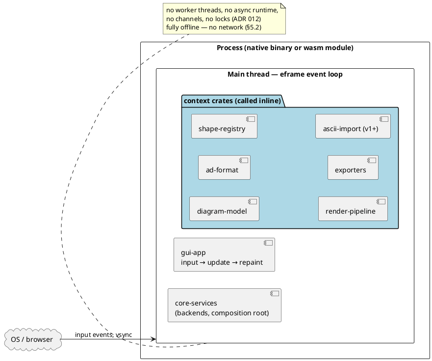
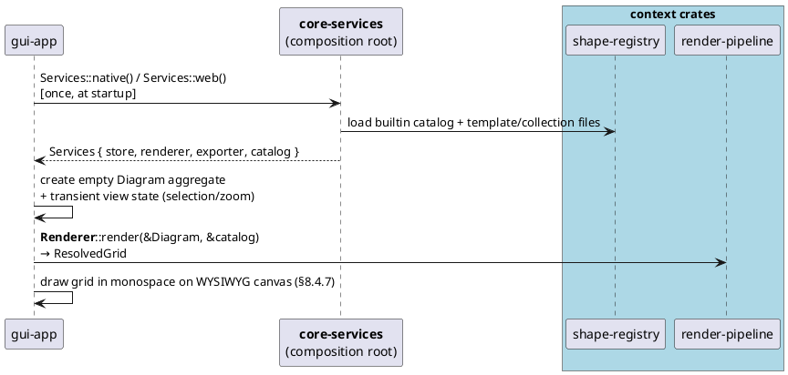
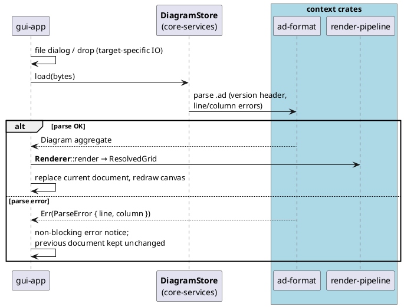
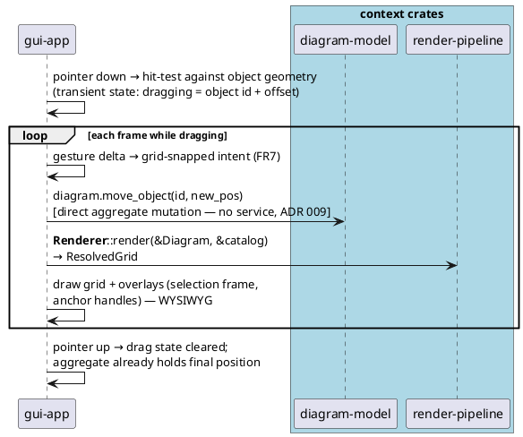
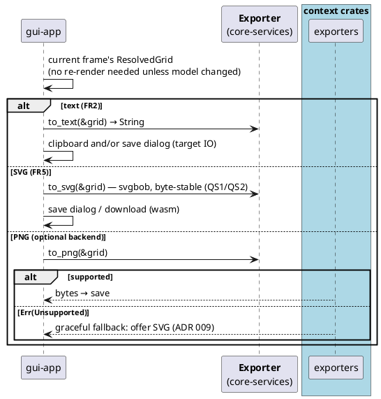
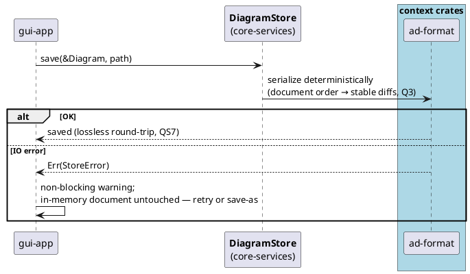
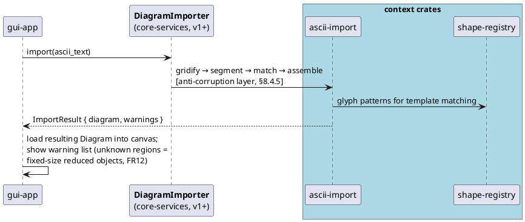

# 9. Runtime View

> *How the system behaves at runtime for the key scenarios.*
>
> *Status note: design-level, no code yet. The concurrency model is decided by [ADR 012](../adr/012-single-threaded-runtime.md) (`proposed`): **single process, single thread** — which makes the runtime communication model a direct consequence of the static coupling strategy ([§8.3](08-building-block-view.md)) rather than a separate design problem. Diagrams in PlantUML per [ADR 003](../adr/003-plantuml-for-doc-diagrams.md).*

## 9.1 Topology: One Process, One Thread

- **Native:** one process; the OS delivers input events + vsync to the eframe loop; all application logic runs inline in that thread.
- **Web (wasm32):** same topology with *zero* threads available on the target — the single-thread model is not just simpler, it is the only portable baseline (ADR 012).
- No daemons, no background services, no inter-process communication (§5.2 fully offline).

## 9.2 Communication Model

Because v1 is single-threaded and in-process ([ADR 012](../adr/012-single-threaded-runtime.md)), **all communication between components is direct synchronous function calls passing value types** — there is no IPC, no message passing, no shared mutable state, no locking. Concretely:

- The runtime graph **is** the static dependency DAG of [§8.3](08-building-block-view.md): GUI → `ui-api` traits (held as `Arc<dyn …>`) → `core-services` backends → context crates; plus GUI → `diagram-model` value types directly (§8.4.7).
- The *currency* across each boundary is the same as in the static view: opaque `type_id`s, immutable value objects (`CellPos`, `CellSize`, `AnchorRef`), the `Diagram` aggregate, and `ResolvedGrid`.
- **Consequence:** there is no separate "runtime coupling" to design, review, or test — deciding single-threaded *removes* a whole class of communication concerns (ordering, races, backpressure) instead of adding them.
- **The one pre-defined exception** (ADR 012 escape hatch): if PNG rasterization ever exceeds the frame budget, a single optional worker inside `core-services` may be added — one-shot job + result return, no shared state, inline fallback on wasm. Until that happens, the answer to "how do components communicate?" is always: *a function call*.

## 9.3 Key Scenarios

Service names in bold are `ui-api` traits ([ADR 009](../adr/009-ui-api-service-layer.md)); context crates are shown where the work actually happens. All steps run on the main thread.

### RS1: Start & new diagram (trigger: launch)

### RS2: Open a `.ad` file (trigger: menu / file drop)

### RS3: Edit — drag a shape (trigger: pointer gesture; **hot path, P2 ≤ 16 ms/frame**)

*Resize and connect follow the same shape: intent-revealing aggregate op → re-render → repaint.*

### RS4: Export (trigger: menu / shortcut)

### RS5: Save (trigger: menu / shortcut / before close)

### RS6: ASCII import of foreign diagram (v1+, trigger: paste / file)

## 9.4 State Management

- **Single source of truth:** the `Diagram` aggregate, held by the GUI app struct ([C4](12-concepts/diagram-aggregate.md)). One document per session in v1 (multi-document = ADR 009 version-bump territory, §8.4.7).
- **Transient view state** (selection, drag-in-progress, zoom/pan, hover) lives in the same app struct — never in a backend component (§8.4.7). It is discarded on close; it is never serialized.
- **Derived, never stored:** `ResolvedGrid` is recomputed per frame during interaction and cached for the current frame otherwise; `.ad` files contain the model, not grids ([ADR 004](../adr/004-diagram-file-format.md)).
- **Re-render trigger:** any aggregate mutation (gesture frame) or catalog change → re-render. No invalidation bookkeeping beyond "did the model change this frame".

## 9.5 Error Flows

All errors are `Result` values returned synchronously up to the GUI (no panics across crate boundaries, no exceptions — Rust default); the GUI presents them as **non-blocking notices** and keeps the in-memory document authoritative:

| Failure | Where it surfaces | User-visible behavior |
|---------|-------------------|----------------------|
| `.ad` parse error | `DiagramStore::load` → `Err(ParseError { line, column })` | Error notice with position; previous/empty document kept (RS2) |
| Save IO error | `DiagramStore::save` → `Err(StoreError)` | Warning; in-memory copy untouched, retry/save-as offered (RS5) |
| PNG backend missing | `Exporter::to_png` → `Err(Unsupported)` | Fallback offer of SVG — no hard failure (ADR 009, RS4) |
| Import: unknown regions | `DiagramImporter::import` → `ImportResult.warnings` | Diagram loaded with reduced objects + warning list (RS6, FR12) |
| Template/collection file invalid | catalog load at startup | Skipped with warning; builtin catalog always available |
