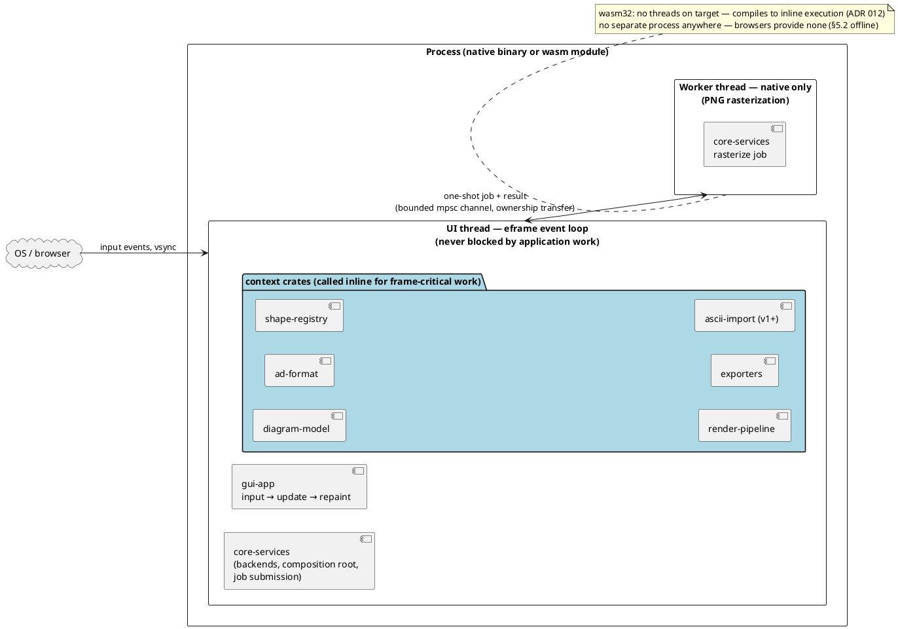
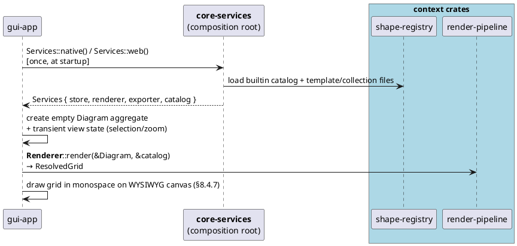
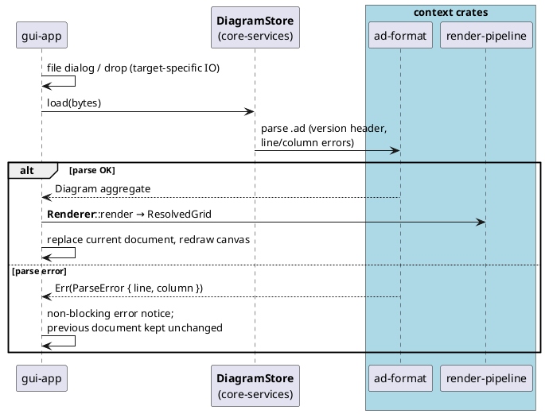
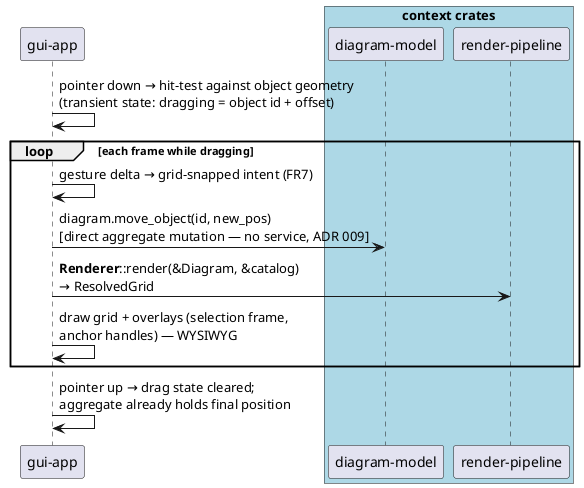
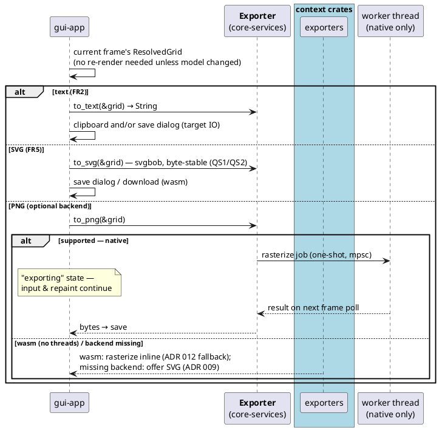
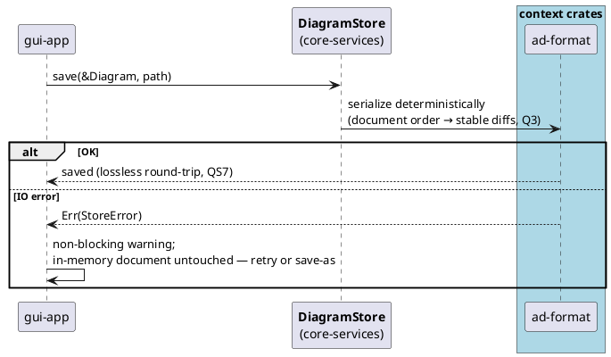
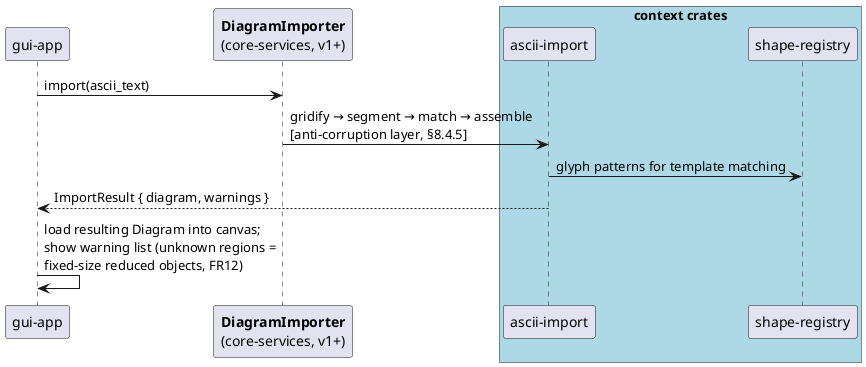

# 9. Runtime View

> *How the system behaves at runtime for the key scenarios.*
>
> *Status note: the concurrency model is decided by [ADR 012](../adr/012-responsive-ui-threading.md) (`accepted`, v2): **a dedicated UI thread that is never blocked by application work** — frame-critical work runs inline on it, non-frame work (PNG rasterization) runs on a worker thread (native) with inline fallback on wasm. The worker mechanism itself is implemented and tested in `core-services::worker` (S-011: bounded queue + typed overflow, per-frame polling job API, drop drains the finite queue); the GUI wiring of the "exporting" state lands with S-015. This keeps the runtime communication model a small, fixed extension of the static coupling strategy ([§8.3](08-building-block-view.md)) rather than a separate design problem. Diagrams in PlantUML per [ADR 003](../adr/003-plantuml-for-doc-diagrams.md).*

## 9.1 Topology: One Process, Dedicated UI Thread + One Worker (Native)

- **Native:** one process; the UI thread runs the eframe event loop and *only* frame-critical work; a single worker thread handles non-frame work (v1: PNG rasterization).
- **Web (wasm32):** same topology minus the worker — `wasm32-unknown-unknown` has no threads and browsers provide no subprocesses, so non-frame work runs inline. The single-thread web build is a fallback, not the design baseline.
- **Splitting rule (ADR 012):** *must land within this frame → inline on the UI thread; user waits but it need not complete this frame → worker.*
- No daemons, no background services, no IPC (§5.2 fully offline).

## 9.2 Communication Model

Two — and only two — kinds of communication exist at runtime:

1. **Direct synchronous function calls passing value types** — for all frame-critical work and fast operations. The runtime graph for these calls *is* the static dependency DAG of [§8.3](08-building-block-view.md): GUI → `ui-api` traits (held as `Arc<dyn …>`) → `core-services` backends → context crates; plus GUI → `diagram-model` value types directly (§8.4.7). The currency across each boundary is unchanged: opaque `type_id`s, immutable value objects (`CellPos`, `CellSize`, `AnchorRef`), the `Diagram` aggregate, and `ResolvedGrid`.
2. **One-shot job + result via a bounded channel** — for non-frame work (v1: PNG rasterization only). Confined to `core-services`: the GUI submits a job, shows an "exporting" state, and receives the result on a later frame poll. The channel transfers ownership; there is no shared mutable state and no locking beyond the channel itself.

Consequences:

- The UI thread is never blocked by application work ([ADR 012](../adr/012-responsive-ui-threading.md)) — input handling and repaint run between job polls regardless of what the worker is doing.
- There is no general message passing, IPC, or event system — exactly one fixed async boundary inside the application layer; everything else is a function call.
- If a second non-frame operation ever appears, it reuses the same job/result mechanism (ADR 012 follow-up) — no new communication patterns.

## 9.3 Key Scenarios

Service names in bold are `ui-api` traits ([ADR 009](../adr/009-ui-api-service-layer.md)); context crates are shown where the work actually happens. Frame-critical steps run on the UI thread; only RS4's PNG path touches the worker.

### RS1: Start & new diagram (trigger: launch)

### RS2: Open a `.ad` file (trigger: menu / file drop)

### RS3: Edit — drag a shape (trigger: pointer gesture; **hot path, P2 ≤ 16 ms/frame, fully inline**)

*Resize and connect follow the same shape: intent-revealing aggregate op → re-render → repaint. This path is deliberately inline (ADR 012): per-frame work must land within the frame — threading it would only add latency.*

### RS4: Export (trigger: menu / shortcut)

### RS5: Save (trigger: menu / shortcut / before close)

### RS6: ASCII import of foreign diagram (v1+, trigger: paste / file)

## 9.4 State Management

- **Single source of truth:** the `Diagram` aggregate, held by the GUI app struct ([C4](12-concepts/diagram-aggregate.md)). One document per session in v1 (multi-document = ADR 009 version-bump territory, §8.4.7).
- **Transient view state** (selection, drag-in-progress, zoom/pan, hover, export job in flight) lives in the same app struct — never in a backend component (§8.4.7). It is discarded on close; it is never serialized.
- **Derived, never stored:** `ResolvedGrid` is recomputed per frame during interaction and cached for the current frame otherwise; `.ad` files contain the model, not grids ([ADR 004](../adr/004-diagram-file-format.md)).
- **Re-render trigger:** any aggregate mutation (gesture frame) or catalog change → re-render. No invalidation bookkeeping beyond "did the model change this frame".

## 9.5 Error Flows

All errors are `Result` values returned synchronously up to the GUI (no panics across crate boundaries, no exceptions — Rust default); worker results arrive via the same job/result channel as a `Result`. The GUI presents everything as **non-blocking notices** and keeps the in-memory document authoritative:

| Failure | Where it surfaces | User-visible behavior |
|---------|-------------------|----------------------|
| `.ad` parse error | `DiagramStore::load` → `Err(ParseError { line, column })` | Error notice with position; previous/empty document kept (RS2) |
| Save IO error | `DiagramStore::save` → `Err(StoreError)` | Warning; in-memory copy untouched, retry/save-as offered (RS5) |
| PNG backend missing | `Exporter::to_png` → `Err(Unsupported)` | Fallback offer of SVG — no hard failure (ADR 009, RS4) |
| PNG rasterization error | worker result → `Err` via channel | "exporting" state cleared; SVG fallback offered (RS4) |
| Import: unknown regions | `DiagramImporter::import` → `ImportResult.warnings` | Diagram loaded with reduced objects + warning list (RS6, FR12) |
| Template/collection file invalid | catalog load at startup | Skipped with warning; builtin catalog always available |
